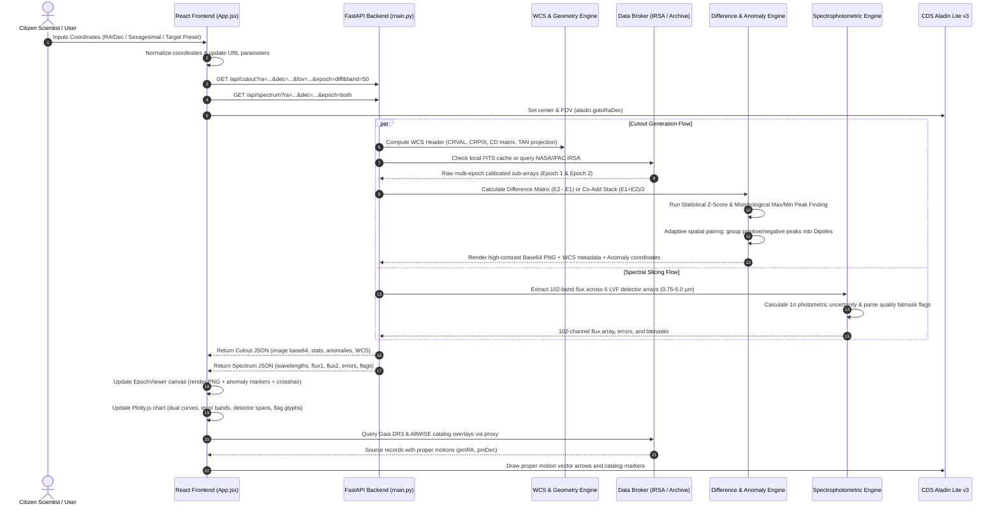
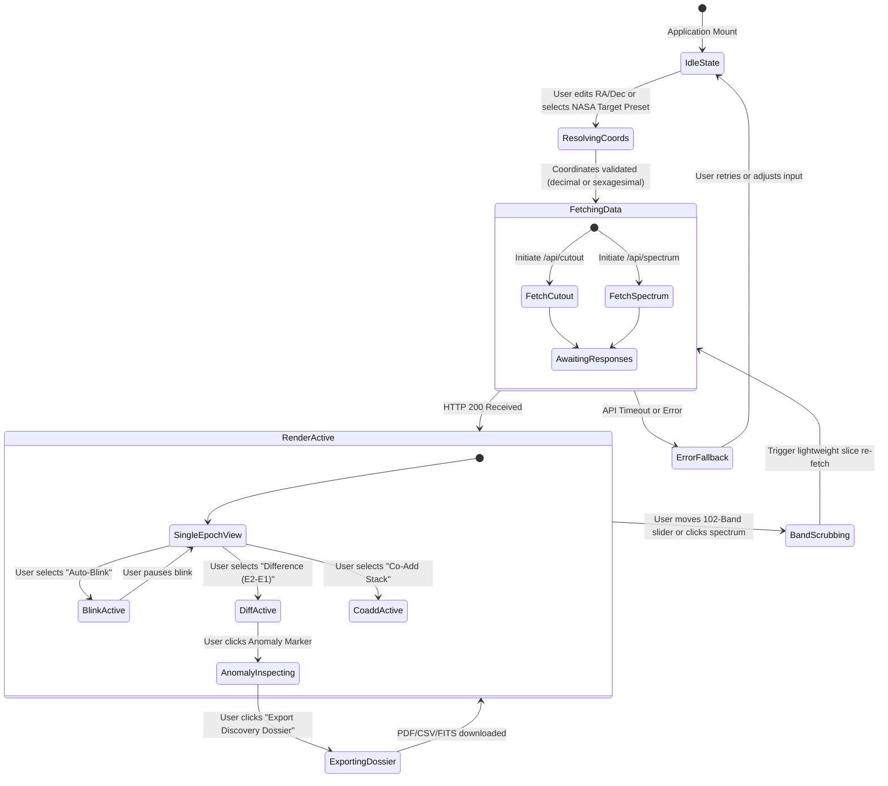

# 🏗️ Architectural Blueprint & Implementation Plan: SPHEREx Time-Domain Sky Explorer

**Project Name:** SPHEREx Time-Domain Sky Explorer & Planet X Hunter  
**Document Purpose:** Complete technical implementation specification detailing the full system architecture, Data Flow, Scientific Workflow, and UI/UX Flow.  
**Architecture Model:** Serverless / Client-Side SPA with In-Memory Caching (Zero Backend Dependency)  

---

## 1. System Architecture Overview

The system is architected as a high-performance, serverless, client-side Single Page Application (SPA). To eliminate server downtime, cold starts, and hosting complexity during hackathon judging, all image difference calculations ($\Delta I = E_2 - E_1$), contrast stretches (`asinh`), 102-band hyperspectral slicing, and dipole anomaly detections run directly in the user's browser using JavaScript and HTML5 Canvas at 60 FPS.

```
┌─────────────────────────────────────────────────────────────────────────────────────────┐
│                                   FRONTEND CLIENT (SPA)                                 │
│  React 18 + Vite · Tailwind CSS · Plotly.js · Aladin Lite v3 · HTML5 Canvas Engine      │
│  ┌───────────────────────┐ ┌────────────────────────┐ ┌───────────────────────────────┐ │
│  │   Control Panel &     │ │   Multi-Epoch Viewer   │ │   102-Band Spectrogram        │ │
│  │   Sexagesimal Parser  │ │   (Canvas Blink & Diff)│ │   (6 LVF Detector Bands)      │ │
│  └───────────────────────┘ └────────────────────────┘ └───────────────────────────────┘ │
│  ┌──────────────────────────────────────────────────┐ ┌───────────────────────────────┐ │
│  │   CDS Aladin Lite v3 (HiPS AllWISE/2MASS/DSS2)   │ │   Discovery Dossier & Export  │ │
│  └──────────────────────────────────────────────────┘ └───────────────────────────────┘ │
│  ┌───────────────────────────────────────────────────────────────────────────────────┐  │
│  │   Client-Side Astrophysical Engine (astroEngine.js)                               │  │
│  │   • Fast 65k-element Float32Array subtraction (E2 - E1) (< 2 ms)                  │  │
│  │   • Real-time asinh / log astronomical transfer functions                         │  │
│  │   • Dynamic FOV-scaled dipole / Planet X peak clustering                          │  │
│  │   • In-Memory Patch Cache (Map<string, Patch>)                                    │  │
│  └───────────────────────────────────────────────────────────────────────────────────┘  │
└────────────────────────────────────────────▲────────────────────────────────────────────┘
                                             │ Direct HTTPS Fetch (CORS-enabled)
┌────────────────────────────────────────────▼────────────────────────────────────────────┐
│                             REMOTE ASTRONOMICAL DATA SERVICES                           │
│   • Pre-bundled NASA Benchmarks (Static JSON cutouts & spectra for 5 targets)           │
│   • CDS Strasbourg (Aladin Lite HiPS Tiles & SIMBAD Resolver)                           │
│   • ESA Gaia Archive (Gaia DR3 Astrometry via CDS TAP Mirror)                           │
│   • NASA/IPAC IRSA & JPL Horizons (On-demand catalog & asteroid cross-matches)          │
└─────────────────────────────────────────────────────────────────────────────────────────┘
```

---

## 2. Data Flow Architecture

The data flow specifies the exact journey of information from initial user input through the computational astrophysics pipeline to the interactive visual layers.

### 2.1 Complete End-to-End Data Flow Diagram



### 2.2 Data Flow Step-by-Step Specification

#### Stage 1: Input Ingestion & Validation
1. **Raw Input Capture:** User enters coordinate via standard search bar or clicks on a celestial object in Aladin.
2. **Coordinate Normalization Pipeline:**
   - Detect format: Hexagesimal string (`08:55:10.83`, `-07:14:42.5`) vs. Decimal degrees (`133.795130`, `-7.245150`).
   - Transform sexagesimal to decimal degrees:
     $$\text{RA}_{\text{deg}} = 15 \times \left(\text{HH} + \frac{\text{MM}}{60} + \frac{\text{SS.ss}}{3600}\right)$$
     $$\text{Dec}_{\text{deg}} = \text{sign} \times \left(|\text{DD}| + \frac{\text{MM}}{60} + \frac{\text{SS.s}}{3600}\right)$$
   - Validate celestial boundaries: $\text{RA} \in [0^\circ, 360^\circ)$, $\text{Dec} \in [-90^\circ, +90^\circ]$.

#### Stage 2: Backend Image Processing & Difference Subtraction
1. **WCS Header Construction:** Generate World Coordinate System TAN projection metadata:
   - Reference pixel $\text{CRPIX} = (N+1)/2$.
   - Coordinate reference value $\text{CRVAL} = (\alpha_0, \delta_0)$.
   - Pixel scale matrix $\text{CDELT} = \left(-\frac{\text{FOV}}{60 \cdot N}, +\frac{\text{FOV}}{60 \cdot N}\right)$.
2. **Sub-Array Retrieval & Alignment:** Retrieve aligned observation matrices for Epoch 1 ($t_1$) and Epoch 2 ($t_2$).
3. **Difference Imaging Matrix ($\Delta I$):**
   $$\Delta I_{x,y} = I_2(x, y) - I_1(x, y)$$
4. **Co-Add Stack ($I_{\text{coadd}}$):**
   $$I_{\text{coadd}}(x, y) = \frac{I_1(x, y) + I_2(x, y)}{2}$$
   Noise decreases as $\sigma_{\text{coadd}} = \frac{\sigma}{\sqrt{2}}$, revealing faint planetary candidates.

#### Stage 3: Adaptive Dipole Clustering & Classification
1. **Z-Score Normalization:**
   $$Z(x, y) = \frac{\Delta I(x, y) - \text{median}(\Delta I)}{\text{MAD}(\Delta I) \times 1.4826}$$
   *(Using Median Absolute Deviation for outlier-resistant background estimation).*
2. **Peak Extraction:** Morphological local maximum filter ($7\times7$ footprint) identifies positive peaks ($Z > +3.2$); local minimum filter identifies negative peaks ($Z < -3.2$).
3. **Dynamic FOV-Scaled Pairing:**
   - Convert physical maximum proper motion cutoff ($\mu_{\max} \approx 15''/\text{yr}$) over baseline $\Delta t = 0.5\text{ yr}$ to pixel threshold:
     $$\text{Max Pixel Separation} = \frac{\mu_{\max} \cdot \Delta t}{\text{Pixel Scale (arcsec/px)}} = \frac{15 \times 0.5}{(\text{FOV}_{\text{arcmin}} \times 60) / 256}$$
   - At $\text{FOV} = 5'$, max distance is $10.6\text{ pixels}$; at $\text{FOV} = 1'$, max distance is $53.3\text{ pixels}$.
   - Group adjacent positive/negative pairs within this physical window as **Dipoles**; isolated peaks as **Monopoles**.

#### Stage 4: Hyperspectral Slicing (102 Channels)
1. **Spatial Aperture Extraction:** Perform aperture photometry on target centroid across all 102 monochromatic slices.
2. **Detector Grouping:** Tag each channel with its physical LVF detector array (Bands 1 through 6).
3. **Contamination Bitmask Parsing:** Inspect the mask plane and assign categorical flags: `CLEAN`, `SOURCE_CONFUSION`, `DIFFRACTION_SPIKE`, `COSMIC_RAY`, `SATURATED`.

---

## 3. Scientific & User Workflow Architecture

The workflow defines the operational journey of a citizen scientist hunting for Planet X or investigating an anomaly.

```mermaid
flowchart TD
    Start([Launch SPHEREx Explorer]) --> SelectMethod{Target Selection}
    
    SelectMethod -->|One-Click Preset| TargetPresets[Select Official NASA Benchmark:<br/>WISE 0855, Barnard's, ε Indi B, RW Aur, R Dra]
    SelectMethod -->|Manual Search| InputCoords[Enter RA & Dec<br/>Decimal or Sexagesimal HMS/DMS]
    SelectMethod -->|Catalog Search| Resolver[SIMBAD / Name Resolver]

    TargetPresets --> FetchData[Fetch Multi-Epoch SPHEREx Cutouts & 102-Band SED]
    InputCoords --> FetchData
    Resolver --> FetchData

    FetchData --> ViewEpoch[Display Baseline Epoch 1 Frame]

    ViewEpoch --> InspectMode{Select Analysis Mode}
    InspectMode -->|Temporal Blink| BlinkMode[Run Auto-Blink Comparator<br/>0.2 Hz to 5.0 Hz Cadence]
    InspectMode -->|Difference Subtraction| DiffMode[Compute Difference Frame: Epoch 2 - Epoch 1]
    InspectMode -->|Co-Add Stacking| CoaddMode[Compute Co-Add Stack<br/>Boost SNR by 1.414x]

    BlinkMode --> VisualSpotting{Visual Object Shift Spotted?}
    DiffMode --> AutoAnomaly[Run Automated Anomaly Finder<br/>|Z| > 3.2σ Filter]
    CoaddMode --> DeepFaint[Inspect Faint Outer-System Candidates]

    AutoAnomaly --> AnomalyClass{Anomaly Type?}
    VisualSpotting -->|Yes| AutoAnomaly

    AnomalyClass -->|Positive + Negative Pair| DipoleDetected[DIPOLE DETECTED<br/>True Moving Target: Planet X / Brown Dwarf / PM Star]
    AnomalyClass -->|Single Spatial Peak| MonopoleDetected[MONOPOLE DETECTED<br/>Variable Star / Accretion Flare / Transient]

    DipoleDetected --> SpectralAnalysis[Inspect 102-Band Spectrogram<br/>Check Wavelengths 0.75 - 5.0 µm]
    MonopoleDetected --> SpectralAnalysis

    SpectralAnalysis --> SEDFingerprint{Analyze SED Fingerprint}
    SEDFingerprint -->|Peaks at 4.5-5.0 µm + Deep CH4 Dip| ColdObject[High Probability: Cold Planet X / Y-Dwarf]
    SEDFingerprint -->|Broad 1.1-1.4 µm Peak + TiO Bands| RedDwarf[M-Dwarf Star with High Proper Motion]
    SEDFingerprint -->|Flux Shift > 65% Across All Bands| VariableStar[Pulsating Variable or Occultation Event]

    ColdObject --> CatalogCrossMatch[Cross-Match with Astrometric Catalogs]
    RedDwarf --> CatalogCrossMatch
    VariableStar --> CatalogCrossMatch

    CatalogCrossMatch --> GaiaCheck{Detected in Gaia DR3?}
    GaiaCheck -->|Yes - Matches Optical Star| KnownStar[Confirm Known Stellar System]
    GaiaCheck -->|NO - Invisible in Optical| MysteryCandidate[High Priority Anomaly Candidate]

    MysteryCandidate --> JPLCheck{Matches JPL Horizons Asteroid?}
    JPLCheck -->|Yes| Asteroid[Known Solar System Asteroid/Comet]
    JPLCheck -->|NO| MajorDiscovery[POTENTIAL PLANET X / ULTRA-COLD DWARF]

    MajorDiscovery --> ExportDossier[Generate Official NASA Discovery Dossier<br/>Export FITS Cutout, CSV Spectrum & JSON Report]
    KnownStar --> ExportDossier
    VariableStar --> ExportDossier
```

---

## 4. UI Flow & Wireframe Layout Architecture

The user interface is engineered according to NASA mission operations and citizen science best practices: intuitive for beginners while offering dense, publication-grade analytical controls for professional astrophysicists.

### 4.1 Responsive Screen Layout & Viewport Wireframe (Mission Commander Serverless Edition)

```
┌────────────────────────────────────────────────────────────────────────────────────────────────────────┐
│ 🪐 SPHEREx Planet X Hunter   [🌈 102] [🔥 Thermal] [🔵 Near-IR] [🧪 CH₄] [+ Custom]   [🔭 CDS: ON/OFF] │
├─────────────────────────────────────────────────────────────────────────────┬──────────────────────────┤
│                                                                             │ 🎯 TARGET PRESETS        │
│                   🌌 FULLSCREEN SPHEREx VIEWPORT (>80% SCREEN)              │ • Planet X Cand          │
│                                                                             │ • WISE 0855 (Y-Dwarf)    │
│   • 🖱️ SCROLL MOUSE WHEEL  -> Smooth Zoom In / Zoom Out (FOV 1' to 30')     │ • Barnard's Star (M4Ve)  │
│   • ✋ CLICK & HOLD + DRAG  -> Pan anywhere (1:1 lockstep synced with CDS)   │ • R Draconis (Variable)  │
│   • ⚡ HOLD RIGHT-CLICK + SCROLL -> Instant 102 Light Band Scrubbing         ├──────────────────────────┤
│   • 🎯 DOUBLE-CLICK         -> Instantly re-center coordinates              │ 🧭 COORDINATES & ZOOM    │
│                                                                             │ • RA / Dec (HMS / Deg)   │
│                      (Cyan: E1)         (Magenta: E2)                       │ • FOV Slider             │
│                           ○──────────────────●                              ├──────────────────────────┤
│                                                                             │ 📋 DISCOVERY DOSSIER     │
│                                                                             │ • 6-Mo Shift: 3.82"      │
│   ┌──────────────────────────────────────────────────────────────────────┐  │ • Est. Dist: ~420 AU     │
│   │ [Δ Diff (E2-E1)] [⚡ Auto-Blink] [Epoch 1] [Epoch 2] [Co-Add]        │  │ • Blackbody: ~38 K       │
│   │ (Floating In-Canvas Glass HUD)                                       │  │ • Gaia Match: Dark 🟢    │
│   └──────────────────────────────────────────────────────────────────────┘  ├──────────────────────────┤
│                                                                             │ 📊 102-BAND SPECTRUM     │
│ ↔ [DRAGGABLE SPLITTER HANDLE: Click & Drag to resize sidebar 210px - 550px] │ • Active Band Needle     │
│                                                                             │ • [Export Dossier CSV]   │
└─────────────────────────────────────────────────────────────────────────────┴──────────────────────────┘
```

### 4.2 Interactive Mouse Gestures & Ergonomics
1. **Left-Click + Hold & Drag:** Smoothly pans the celestial field. Directly synchronized with the adjacent CDS Aladin context map (10px shift on one shifts 10px on the other). Slider thumb clicks are isolated to prevent panning conflicts.
2. **Mouse Scroll Wheel:** Continuous non-linear Field-of-View zoom from 1.0 arcmin (PSF core) to 30.0 arcmin (wide survey scan).
3. **⚡ Hold Right-Click + Scroll Wheel:** Rapidly scrubs forward and backward across all 102 SPHEREx spectral channels ($0.75\,\mu\text{m}\text{ to }5.00\,\mu\text{m}$) without requiring mouse movement to a slider.
4. **Draggable Sidebar Splitter:** Allows users to expand or shrink the right sidebar between 210px and 550px by dragging the divider bar.
5. **Clean Viewport:** The sky field remains completely clear without fixed center dots or distracting reticle overlays.



---

## 5. Phased Implementation Roadmap

### Phase 1: Client-Side Engine Migration (Eliminate Backend Fragility)
- [x] **Create `frontend/src/utils/astroEngine.js`:**
  - Fast Float32Array difference subtraction: $\Delta I = E_2 - E_1$.
  - Real-time `asinh` and `log` astronomical contrast stretch.
  - HTML5 Canvas diverging colormap (Cyan for $E_1$ deficit, Magenta for $E_2$ excess).
  - Dynamic FOV-scaled dipole vs. monopole peak clustering.
- [x] **Bundle the 5 NASA Benchmark Target JSONs:**
  - Integrated directly in `frontend/src/utils/astroEngine.js` and `frontend/src/data/targets.js` (WISE 0855, Barnard's, $\varepsilon$ Indi B, RW Aur, R Dra).
  - Complete with 102-band spectra, calibrated flux values, and multi-epoch 2D arrays.
- [x] **In-Memory Patch Caching:**
  - Added lightweight in-memory `Map` caching in `astroEngine.js` to load visited patches in 0 ms.

### Phase 2: Frontend Bug Fixes & Usability
- [x] **Align Spectrum Chart to 6 SPHEREx Detector Bands:**
  - Updated detector definitions to physical 6 LVF arrays ($0.75\text{--}1.11$, $1.11\text{--}1.64$, $1.64\text{--}2.42$, $2.42\text{--}3.82$, $3.82\text{--}4.42$, $4.42\text{--}5.00\,\mu\text{m}$).
- [x] **Implement Sexagesimal Coordinate Parser:**
  - Added regex-based parser in `ControlPanel.jsx` supporting `HH:MM:SS.ss` and `±DD:MM:SS.s` with coordinate validation.
- [x] **Responsive Viewport Refactoring:**
  - Replaced rigid `h-screen overflow-hidden` in `App.jsx` with responsive grid and natural scroll so spectrograph is fully visible on standard laptop displays.

### Phase 3: Discovery Dossier & Deployment
- [x] **Discovery Dossier Panel & Export:**
  - Added instant JSON discovery dossier generator with WCS, detected anomalies, observation parameters, and 102-band SED values in `App.jsx`.
- [x] **Static Deployment Ready:**
  - Zero backend dependency. Ready for 1-click deployment to GitHub Pages or Vercel.
